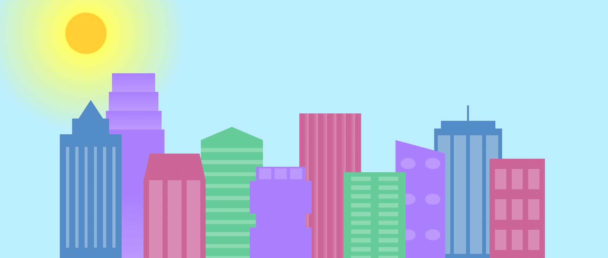

# 🏙️ CSS City Skyline

A pastel city skyline drawn entirely with **HTML and CSS**: no images, no JavaScript, no libraries. The project is a practice ground for **layout, layering, and positioning**, showing how far plain CSS shapes can go.

## Preview



> Add a screenshot of the page as `preview.png` in the project root.

## What's in the scene

- A gradient sky with a glowing sun
- 10+ buildings of different heights, widths, and colors (blue, purple, pink, green)
- Varied rooftops: pointed spire, stepped tower, slanted roof, antenna
- Windows drawn with CSS patterns (vertical stripes, horizontal bands, grids, ovals)
- Overlapping buildings that create depth

## Concepts practiced

- `position: absolute` / `relative` for placing each building precisely
- `z-index` for layering buildings in front of and behind each other
- `linear-gradient` for the sky, sun glow, and building shading
- `border-radius` for the sun and oval windows
- `clip-path` / borders for triangles and slanted roofs
- Pseudo-elements (`::before`, `::after`) for windows and details
- Units and sizing (`px`, `%`, `vh`, `vw`) for anchoring the skyline to the bottom of the page

## Project structure

```
css-city-skyline/
├── build.html      # Markup and styles for the skyline
├── preview.png     # Screenshot (optional)
└── README.md
```

If your CSS lives in a separate file, add it here (e.g. `style.css`).

## Getting started

1. Clone the repo:
   ```bash
   git clone https://github.com/<your-username>/css-city-skyline.git
   ```
2. Open the folder in VS Code.
3. Right-click `build.html` and choose **Open with Live Server**, or just open the file in any browser.

## Customize it

- Change the sky by editing the background gradient on the body.
- Move or resize the sun by adjusting its `top`, `left`, `width`, and `height`.
- Add a building by copying an existing one and changing its `left`, `height`, `width`, `background`, and `z-index`.

## Ideas for next steps

- [ ] Add twinkling stars and a night-mode version
- [ ] Animate clouds drifting across the sky
- [ ] Make the skyline fully responsive
- [ ] Light up windows with CSS animations

## License

Free to use for learning and personal projects.
